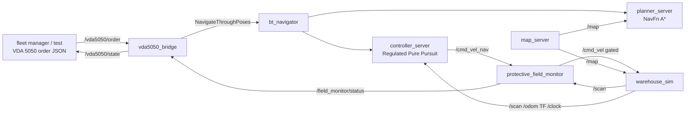

# amr-tugger-nav

A simulated warehouse tugger AMR in ROS 2 Jazzy and C++17: Nav2 drives a VDA 5050 order around a tugger loop, a
speed-dependent **protective field monitor** gates the velocity command like an AMR safety laser scanner would, and an
evaluation runs 270 seeded missions to compare the monitor ON vs OFF (Nav2 alone). Everything builds and runs in Docker;
every number below is produced by `scripts/make_report.py` from `results/raw/*.jsonl`.

**Live replay:** https://huggingface.co/spaces/pavanyadava07/amr-tugger-nav (recorded missions with the protective and
warning fields drawn, same seed ON vs OFF).

> Simulation only. The field monitor is **not** a certified safety function and must not be used as one. No real
> robot or scanner was used.

## What is in it

| part | language | what it does |
|---|---|---|
| `warehouse_sim` | C++ (rclcpp) | Diff-drive kinematics with acceleration and braking limits from `/cmd_vel`, `/odom` + TF, a 270 degree `/scan` ray-cast against the map (Amanatides-Woo grid traversal) plus scripted people, `/clock`, and ground-truth clearance (footprint rectangle vs people discs every 10 ms, exact Euclidean distance transform for racks and walls) |
| `protective_field_monitor` | C++ (rclcpp) | Sits between the Nav2 controller (`cmd_vel_nav`) and the base (`cmd_vel`). Six field sets switched by speed, protective field sized as `v*T + v^2/(2a) + K*(T + v/a) + C`, warning field longer and wider. CLEAR / WARNING (cap 0.3 m/s) / PROTECTIVE_STOP; restart only after the protective field is clear for `hold_time`; stop if scans stop arriving; reversing blocked (no rear scanner). Publishes `tugger_msgs/FieldStatus` |
| `vda5050_bridge` | C++ (rclcpp, rclcpp_action) | VDA 5050 2.1.0 order and instantActions in, validated against the official JSON schemas (vendored, MIT, VDA); semantic checks (sequence ids, edge connectivity, base/horizon, map id, start at the vehicle); order updates; `cancelOrder`; executes the base with `NavigateThroughPoses` / `NavigateToPose`; publishes the VDA 5050 state (`lastNodeId`, `nodeStates`, `edgeStates`, `driving`, `errors`, `safetyState` from the monitor), schema-checked before sending |
| Nav2 | config | map_server, NavFn (A*), Regulated Pure Pursuit, bt_navigator with a tugger behaviour tree (no spin, no back-up), behavior_server (wait only), lifecycle manager |
| tests | C++ / Python | GoogleTest for field geometry, state machine, grid ray-cast and distance transform, kinematics, people, clearance, VDA 5050 parsing / tracking / state schema; a launch_testing test that starts the full stack, sends an order and waits for the state to report it finished |
| `scripts/` | Python (tooling only) | map generator, mission runner (rclpy), parallel evaluation, report, Space data |



## Results

<!-- results:start -->
Measured in simulation on AMD EPYC 7R13 Processor inside Docker; 90 missions per condition on the same seeds. Tests: 41 cases, 0 failures.

**Missions with crossing people (60 per condition)**

| metric | OFF (Nav2 alone) | ON (k_approach = 0) | ON (k_approach = 1.6 m/s) |
|---|---|---|---|
| Missions | 60 | 60 | 60 |
| Mission success | 60/60 | 60/60 | 60/60 |
| Mission time mean [s] | 72.23 | 72.48 | 74.46 |
| Mission time p95 [s] | 101.93 | 91.18 | 82.57 |
| Min clearance to a person, worst mission [m] | 0 | 0 | 0 |
| Min clearance to a person, median mission [m] | 0 | 0.072 | 0.259 |
| Missions with a person contact | 35 | 29 | 25 |
| Person contacts (total) | 49 | 37 | 31 |
| Person contacts with the robot moving > 0.05 m/s | 44 | 35 | 31 |
|   robot moving and person ahead of its front edge | 23 | 13 | 12 |
|   person at the robot's side or rear | 25 | 23 | 19 |
| Max robot speed at a contact [m/s] | 1 | 1 | 1 |
| Max robot speed at a front contact [m/s] | 1 | 0.74 | 0.75 |
| Min clearance to racks/walls [m] | 0.436 | 0.449 | 1.075 |
| Protective stops | - (observe only) | 64 | 193 |
|   of which caused by a person | - (observe only) | 64 | 99 |
|   false stops (no person at the trigger point) | - (observe only) | 0 | 94 |
| Warning slowdowns | - (observe only) | 314 | 444 |
| Protective field intrusions observed | 114 | 102 | 209 |
| Time in protective stop per mission, mean [s] | - (observe only) | 2.44 | 7.78 |
| Real-time factor, mean / min | 1 / 1 | 1 / 1 | 1 / 1 |
<!-- results:end -->

How to read it (all values in the table above and in RESULTS.md):

- The monitor reduces contacts where the robot drives into a person and lowers the robot speed at those contacts,
  but it does not remove them. People step out of occluded cross aisles, sometimes closer than the stopping distance,
  and the scripted people never yield.
- Contacts at the robot's side or rear barely change: a forward-looking field cannot see a person walking into the
  flank. A real tugger would need side coverage (more scanners, or field sets for turning) for this.
- Sizing the field with an ISO 13855 style approach speed (k_approach = 1.6 m/s) adds clearance but also causes false
  stops at racks and corners, including in missions without any people.
- With k_approach = 0 there were no false stops in this map, and the mission time cost against Nav2 alone is small.

Full tables, the paired comparison and the exact metric definitions: [docs/RESULTS.md](docs/RESULTS.md).

## Run it

```bash
make all      # docker build (colcon, -Werror) + colcon test + 270-mission evaluation + docs/RESULTS.md + Space data
make test     # GoogleTest + launch_testing only
make eval     # evaluation only: 18 containers in parallel, simulator at real time
make lint     # ruff on the Python tooling
```

Drive one order by hand (A -> B -> C -> D, 20 m):

```bash
docker run --rm -it -v $PWD/scripts:/ws/scripts:ro amr-tugger-nav:jazzy bash -c '. /ws/ros2_ws/install/setup.sh && \
  (ros2 launch tugger_nav sim_stack.launch.py field_monitor:=true > /tmp/launch.log 2>&1 &) && sleep 15 && \
  python3 /ws/scripts/send_order.py A B C D'
```

The mission runner (`scripts/run_missions.py`) shows how orders, scenarios and the state are used from Python.

## The warehouse

`scripts/make_map.py` generates a 32 x 22 m map at 5 cm: rack rows with 2 m cross aisles, a 4 m wide tugger loop
(nodes A to J, 60 m), pallets at receiving and machines at production. People wait inside the cross aisles, hidden
behind the racks, and start walking when the robot comes within a seeded trigger distance (3 to 9 m): 70 % cross the
loop, 30 % stop in the aisle for 3 to 8 s. They do not react to the robot.

## Limits (read before quoting a number)

- **Simulation only, simple dynamics.** Kinematic diff drive with acceleration and braking limits (1.0 m/s^2
  braking in the simulator, 0.8 m/s^2 assumed by the monitor); no wheel slip, no load, no trailers. A real tugger
  train's trailers sweep a wider path in curves; that is not modelled.
- **Perfect localisation.** The simulator publishes `map -> odom` as identity; no AMCL, no sensor noise beyond 1 cm range noise.
- **Not a safety function.** The monitor runs in ordinary ROS 2 software on a non-safe computer over DDS. Real AMRs
  use a certified safety laser scanner and safety PLC with fields validated for the vehicle (ISO 3691-4, IEC 61496-3,
  ISO 13849). The sizing here borrows the S = K*T + C reasoning of ISO 13855 only as a model; parameters are not
  validated against any real scanner or brake. Fields are rectangles ahead of the robot; they do not bend with the
  curvature, and there is one front scanner (270 degrees), so reversing is blocked.
- **Nav2 already has `nav2_collision_monitor`** (polygons, slowdown and stop). This project writes its own monitor to
  show speed-band field switching, ISO 13855 style sizing and hold-time restart as testable C++; in a product the
  scanner's own field sets plus collision_monitor would be the starting point.
- **VDA 5050 subset.** Orders and instantActions arrive as JSON on ROS topics (`/vda5050/order`,
  `/vda5050/instantActions`, `/vda5050/state`), not over MQTT; a broker was left out to keep the stack simple. Node and
  edge actions are not executed (they are reported as FAILED); the only instant action is `cancelOrder`; no
  factsheet, connection or visualization topics. Node orientation is not enforced. Nodes count as traversed within
  0.6 m (or `allowedDeviationXY`). Closed loops are sent to Nav2 in segments, because Nav2's goal checker otherwise
  reports a loop that ends at its start as reached immediately (found during development: every mission
  "finished" in 0.06 s before the fix).
- **JSON schema dialect.** The official 2.1.0 schemas declare draft 2020-12; the validator (pboettch/json-schema-validator)
  implements draft-07. The keywords those schemas use ($ref, definitions, enum, format, items, minimum, maximum,
  required, type) behave the same in both.
- **Real time only.** Nav2's controller server runs on a wall-clock rate, so the simulator is paced at a real-time
  factor of 1.0 and missions run in parallel containers instead of faster than real time.
- **`nav2_loopback_sim`** exists in Jazzy but is Python and ray-casts only the static map (no moving obstacles),
  so the simulator here is a new C++ node.
- **One map, one robot, seeded scenarios.** 90 missions per condition; the numbers describe this setup, not AMRs in
  general.

## Layout

```
ros2_ws/src/tugger_msgs/       FieldStatus.msg
ros2_ws/src/tugger_nav/
  include/ src/                grid, sim, field and VDA 5050 cores (no ROS) + the three nodes
  test/                        GoogleTest suites, launch_testing integration test
  config/ launch/ maps/        Nav2 + monitor parameters, sim_stack.launch.py, generated map
  behavior_trees/              tugger BTs (adapted from Nav2)
  vda5050/                     official VDA 5050 2.1.0 JSON schemas (MIT, VDA), pinned commit
docker/Dockerfile              ros:jazzy-ros-base + Nav2 packages
scripts/                       map, missions, evaluation, report, Space builder
results/                       raw mission records, tests.json, env.json, summary.json
site/                          static Hugging Face Space (index.html, data.json)
```

## Licence

MIT (see LICENSE), Pavan Yadav Annappa. The VDA 5050 schemas are MIT licensed by the Verband der Automobilindustrie;
the behaviour trees are adapted from Nav2 (Apache-2.0). See THIRD_PARTY.md.

This is an independent portfolio project, not affiliated with any AMR manufacturer.
